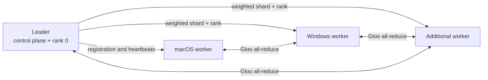

# Heterogeneous Distributed ML Training

A cross-platform leader/worker system for running small distributed-training experiments across commodity macOS and Windows machines connected through Tailscale.

The project focuses on the operational problems around training, not only the model loop: worker discovery, hardware-aware allocation, heartbeats, reconnect behavior, rank assignment, binary shard transfer, synchronized execution, and run reporting.

## What it demonstrates

- **Control plane:** asynchronous worker registration, health checks, bounded reconnect backoff, and leader commands.
- **Heterogeneous scheduling:** workers report benchmark scores; the leader converts them into weighted data slices and bounded batch multipliers.
- **Two execution paths:** federated MNIST model averaging and synchronized CIFAR-10 training with `torch.distributed`.
- **Cross-platform setup:** idempotent bootstrap scripts for macOS and Windows.
- **Experiment visibility:** per-epoch metrics plus CSV and text summaries under `runs/`.



## Training modes

| Mode | Dataset | Coordination | Purpose |
| --- | --- | --- | --- |
| `federated` | MNIST | Leader aggregates completed worker models with weighted FedAvg | Reliable baseline that tolerates workers completing independently |
| `distributed` | CIFAR-10 | Leader and workers join one Gloo process group and synchronize gradients | Data-parallel execution with explicit ranks and world size |

The distributed path currently uses a compact CNN so that the complete workflow can be exercised on laptops. The companion [single-device benchmark](https://github.com/nikhildinesharora/single-device-ml-benchmark) evaluates larger ResNet and ViT workloads on CIFAR-100 and Tiny ImageNet-200.

## Quick start

Requires Python 3.11 or newer. Start locally first, then replace the loopback address with the leader's reachable Tailscale address for a multi-machine run.

### Leader on macOS

```bash
chmod +x leader_macos.sh bootstrap_macos.sh
./leader_macos.sh --host 0.0.0.0 --port 8787
```

At the prompt, use `workers` to inspect the cluster and `start` to begin a run. `help` lists the available commands.

### Worker on macOS

```bash
LEADER_HOST=127.0.0.1 LEADER_PORT=8787 ./bootstrap_macos.sh
```

### Worker on Windows

```powershell
$env:LEADER_HOST = "127.0.0.1"
$env:LEADER_PORT = "8787"
powershell -ExecutionPolicy Bypass -File .\bootstrap_windows.ps1
```

The bootstrap scripts create a virtual environment, install the selected PyTorch build, and launch the worker. Windows detects NVIDIA hardware with `nvidia-smi`; the PyTorch CUDA wheel supplies its own runtime when the installed driver is compatible.

## Synchronized distributed run

Use an address reachable by every participant for `--dist-master-addr`. The control channel and process group use separate ports.

```bash
./leader_macos.sh \
  --mode distributed \
  --host 0.0.0.0 \
  --dist-master-addr 100.x.y.z \
  --dist-port 29501 \
  --distributed-samples 5000 \
  --distributed-batches-per-epoch 10 \
  --distributed-timeout 120 \
  --epochs 5
```

The leader includes itself as rank 0, snapshots the available workers, computes benchmark-weighted slices, sends shards as length-prefixed binary payloads, and starts the process group. Workers continue emitting control-plane heartbeats while their training threads participate in synchronization.

## Useful controls

```bash
# Federated run with explicit limits
./leader_macos.sh \
  --train-batches-per-epoch 200 \
  --batch-size 64 \
  --epochs 5 \
  --eval-batches 40

# Demonstrate admission control
./leader_macos.sh --max-workers 5
```

Per-run overrides are also available from the leader prompt:

```text
start epochs=5 batches=100 lr=0.03
```

## Repository layout

```text
dml_cluster/
  leader.py                Worker lifecycle, scheduling, aggregation, and reports
  worker.py                Registration, heartbeat, reconnect, and training threads
  protocol.py              JSON-line control messages and bounded binary payloads
  distributed_data.py      Weighted shard allocation and batch multipliers
  distributed_training.py  Process-group setup and synchronized training
  training.py              Federated local training and evaluation
  hardware.py              Device discovery and benchmark reporting
tests/                      Deterministic tests for scheduling and protocol helpers
bootstrap_macos.sh          macOS worker setup
bootstrap_windows.ps1       Windows worker setup
leader_macos.sh             Leader launcher
```

## Verification

The deterministic scheduling and wire-protocol helpers are covered with standard-library unit tests:

```bash
python -m unittest discover -s tests -v
```

GitHub Actions runs the suite on Python 3.11 and 3.12.

## Scope and limitations

This is an academic systems prototype, not a fault-tolerant production trainer. The control channel is intended for a trusted private network, distributed membership is fixed for the duration of a synchronized run, and worker loss during an all-reduce requires restarting that run. Model checkpoints and datasets are intentionally excluded from version control.
